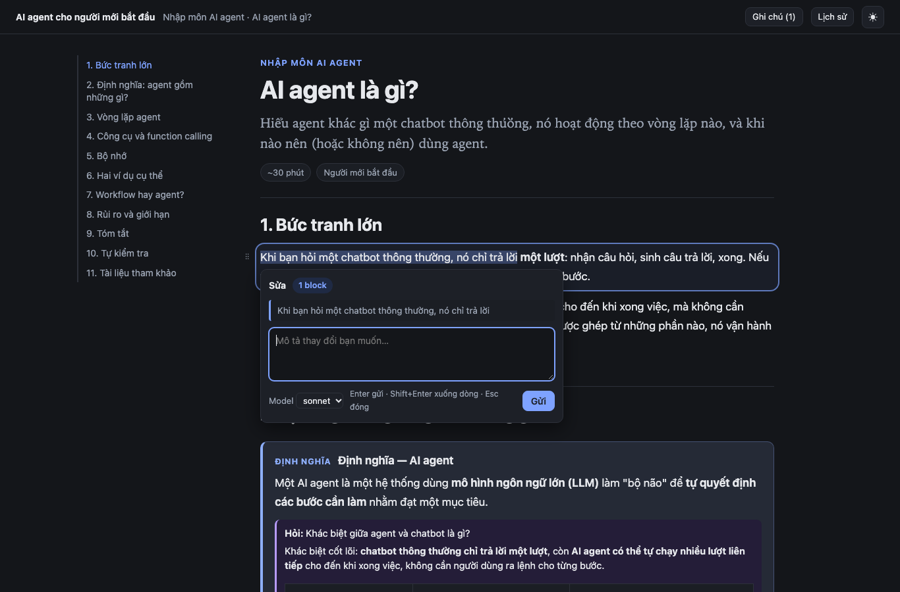
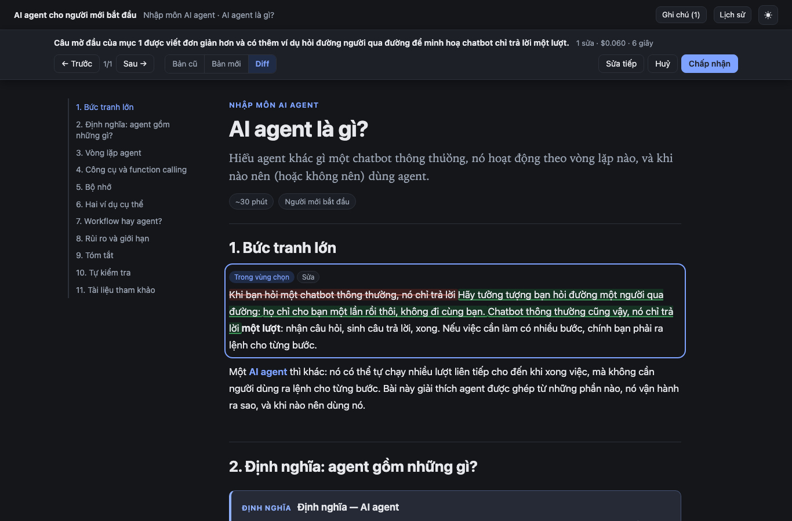

# learndoc

A [Claude Code](https://claude.com/claude-code) skill that turns a prompt plus your references
(PDF, Markdown, web pages) into an interactive learning document on any topic — and lets you
**edit it in the page**: select a passage, type what you want changed, review the change set,
accept or cancel.

## Demo
https://github.com/user-attachments/assets/6a6af30a-d542-4ff8-b18b-83a76d9aade7



## What you get

- **Lessons grounded in your sources.** Every content block cites the exact PDF page or
  Markdown/web section it comes from; `finalize` rejects citations that do not exist.
- **A real learning page.** Headings with a table of contents, definition/example/pitfall boxes,
  KaTeX formulas, code blocks, SVG figures, quizzes, and built-in interactive widgets
  (`vector-plane`, `distribution-bars`, `function-plot`).
- **In-page editing.** Select text (or whole blocks) and choose *Edit*, *Insert after* or *Ask*.
  The change comes back as a change set you preview in place — old / new / diff — and accept,
  cancel or refine. Related edits elsewhere in the lesson (renamed notation, cross-references)
  are included with a reason for each.
- **History.** Every accepted change is a git commit in your project; restore any earlier version
  from the page.
- **Local and private.** A local server on `127.0.0.1` runs `claude -p` with your existing Claude
  Code login. No API key, no hosting.



## Requirements

- [Claude Code](https://claude.com/claude-code), logged in
- Node.js 22 or newer
- Google Chrome or Chromium: required to import an existing HTML course; otherwise optional
  (`finalize` uses it to check each page in a headless browser and skips that check without it)
- git

No `npm install` is needed: KaTeX and pdf.js are vendored and the validators are precompiled.

## Install

**For every project** — clone into your personal skills folder:

```bash
cd ~/.claude/skills && git clone https://github.com/Learnheart/Learndoc.git
```

**For one project only** — clone into that project's skills folder:

```bash
cd <your-project>/.claude/skills && git clone https://github.com/Learnheart/Learndoc.git
```

The folder name doesn't matter, and a symlink to a clone kept elsewhere works too. Start a new
Claude Code session; `learndoc` appears in the skill list. Update with `git pull`.

## Usage

Work in an empty folder — one folder holds one course. Put your references in it (or point
Claude at files and URLs), then just ask:

```text
Create a short lesson explaining what an AI agent is for beginners, based on references/agent-notes.md
Tạo khoá học 3 bài về Rust ownership từ references/rust-book.pdf và https://doc.rust-lang.org/book/ch04-00-understanding-ownership.html
```

Claude writes the course, checks it, opens it in your browser and replies with a single link.
For a course with two or more lessons it first shows you the outline to confirm.

Then, in the page:

1. Select a sentence (or click the handle left of a block; Shift+click for a range; Alt+drag for a
   rectangle).
2. Pick **Sửa / Edit**, **Chèn sau / Insert after** or **Hỏi / Ask** (or press ⌘/Ctrl+K), type your
   request, press Enter.
3. Review the preview: jump between changes, switch old / new / diff, untick groups you don't want.
4. **Accept** (commits the lesson), **Cancel**, or select text in the preview and **Refine**.

Ask answers appear as notes beside the block and never change the lesson. **History** lists every
change; restoring one also undoes the changes after it.

### Open it again without Claude

- **To read:** double-click `html/index.html` (or any `html/<lesson>.html`). The `html/` folder is
  self-contained (styles, math fonts and images in `html/_assets/`), opens offline and can be zipped
  and sent to anyone; a single page copied out of it loses its styles and math. The pages are
  rewritten after every accepted change.
- **To edit:** double-click `Mở khoá học.command` (`Open course.command` for an English course;
  `.cmd` on Windows) in the course folder. It starts the local server, or reuses it, and opens the
  editable page. While the server runs, the **Edit** button on a standalone page goes straight to the
  editor; if it is not running, the button tells you to use the launcher.
- **To save as PDF:** open a lesson and print it (⌘P / Ctrl+P → *Save as PDF*). The printout is
  the static lesson on a light background: the top bar, contents, editor, notes and interactive
  widgets are left out, and quiz answers are printed under their questions.

Later, in Claude Code:

| You say | Claude does |
|---|---|
| "mở lại bài học" / "reopen the course" | Restarts or reuses the local server and gives you the link |
| "add a lesson about lifetimes" | Writes one more lesson into the course |
| "rewrite the intro of lesson 2" | Opens that lesson; edits always go through the page |

## Bring an existing HTML course

Already have a course as HTML pages (hand-written, exported, or generated earlier)? Work in a new
empty folder and ask. If you ask from inside the course folder, Claude creates `<folder>-learndoc`
next to it.

```text
Chuyển khoá học HTML trong ~/courses/math-for-ml sang learndoc
Import my existing HTML course from ../old-site into this folder
```

Claude looks at the index and one page, writes a small `import-profile.json` only if the pages
need it, and runs the import. The conversion itself makes no model calls: headless Chrome reads each
page with scripts off. Each imported page becomes a lesson that records which page it came from (path and hash);
no copy of the page is kept under `references/`.

- **Kept:** text, headings, boxes/callouts, KaTeX math, code, inline SVG and local images,
  collapsible quizzes, links between pages, lesson order from the index.
- **Converted later:** interactive demos become note boxes. Claude turns the ones a built-in
  widget can reproduce into widgets; the rest stay as notes (with their original title and hint).
- **Lost:** pages that redirect or are built entirely by JavaScript (skipped), the script-built
  parts of other pages (they import partially), MathJax output without its TeX
  source, iframes, video, audio, embeds, forms and remote images; nothing is fetched from the
  network, and `http://` links become plain text. The import report counts what was
  dropped.

## What it creates in your project

```text
your-course/
├── learndoc.json        language, audience, reference aliases, extra box types
├── course.json          modules and lessons (the course index is rendered from it)
├── lessons/<id>.json    one lesson = an ordered list of typed blocks
├── references/          your sources (empty after an import until you add the course's own)
├── assets/              images used by figures (copied from the source on import)
├── import-profile.json  only after an import that used a profile
├── html/                standalone pages, one per lesson + index.html, and _assets/ (styles,
│                        KaTeX, figure images) they share (generated, git-excluded)
├── Mở khoá học.command  launcher for the editor (generated, git-excluded; name follows the language)
└── .learndoc/           local state: server.json, changesets, notes, refs/ (an index of each
                         reference, plus the extracted text of PDFs), and import/report.json +
                         import/demos/ after an import (git-ignored)
```

The lesson JSON is the source of truth; the editor renders the HTML from it on demand, and `html/`
is regenerated from it after every finalize, accept, restore and server start. Both generated entries
are listed in the repository's `.git/info/exclude`, so the project's own `.gitignore` is left alone.

## How it works

```text
prompt + references ──▶ Claude (SKILL.md) ──▶ learndoc.json, course.json, lessons/*.json
                                                   │
                                   finalize: validate → render → check → browser-check
                                                   │
                                     serve: local server ──▶ browser page + editor
                                                   │
           selection + request ──▶ server ──▶ claude -p (no tools, JSON schema output)
                                                   │
                         change set ──▶ same checks as finalize ──▶ preview ──▶ accept = git commit
```

- Claude runs three internal commands (`bin/learndoc.mjs`): `finalize <file> --json`,
  `serve [--lesson <id>]` and `import <source-dir> [--profile <file>] --json`. You never need to
  run them yourself.
- The editor maps your selection to the exact characters in the lesson source, so the model
  knows precisely which words you meant.
- The server binds to `127.0.0.1`, uses a random per-start token (cookie + header + origin
  checks), and only ever writes the lesson file on accept.

Details: [`SKILL.md`](SKILL.md), [`references/`](references) (authoring, planning, edit,
import and delivery contracts, widget catalog) and [`docs/contracts.md`](docs/contracts.md) (module
interfaces).

## Development

```bash
npm install                    # dev tools only: ajv, katex, pdfjs-dist
npm test                       # unit tests (headless Chrome tests are skipped without Chrome)
npm run generate:validators    # after editing schemas/
npm run vendor                 # refresh runtime/vendor from node_modules
node test/e2e/journey.mjs <project-dir> --out <shots-dir>   # drive the real editor end to end
```

`test/fake-claude/` provides a stand-in for `claude` (set `LEARNDOC_CLAUDE_BIN`) so the server
tests never call the real model. `test/e2e/journey.mjs` does call it, against a running project.

## Limitations

- Edits apply to one lesson at a time; changes that should ripple into other lessons are only
  reported.
- Interactive demos come from the three built-in widgets; when none fits, Claude draws a static
  SVG figure instead.
- Standalone pages are read-only, and their Edit button needs the server started by the launcher.
- PDF is one lesson at a time, through the browser's print dialog; widgets are not printed, so text
  that tells the reader to drag or click a widget stays in the printout.
- Restore works per change, not per block.

## License

MIT — see [LICENSE](LICENSE). Vendored KaTeX (MIT) and pdf.js (Apache-2.0), and portions adapted
from [archify](https://github.com/tt-a1i/archify) (MIT), are listed in
[THIRD_PARTY_NOTICES.md](THIRD_PARTY_NOTICES.md).
